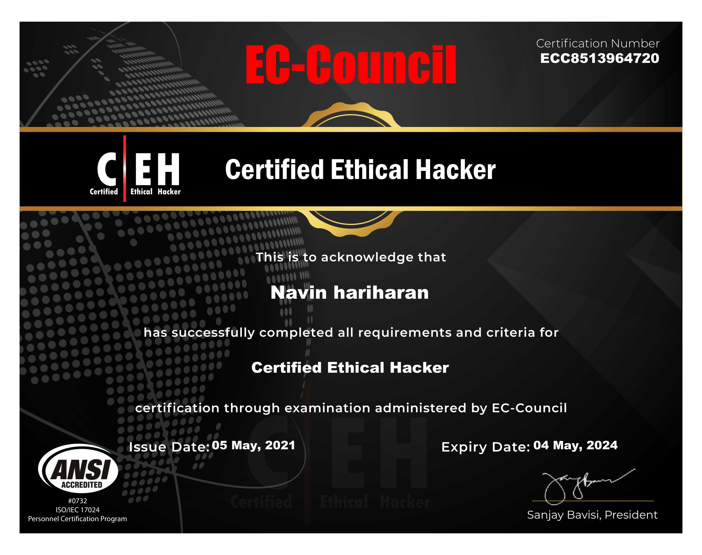
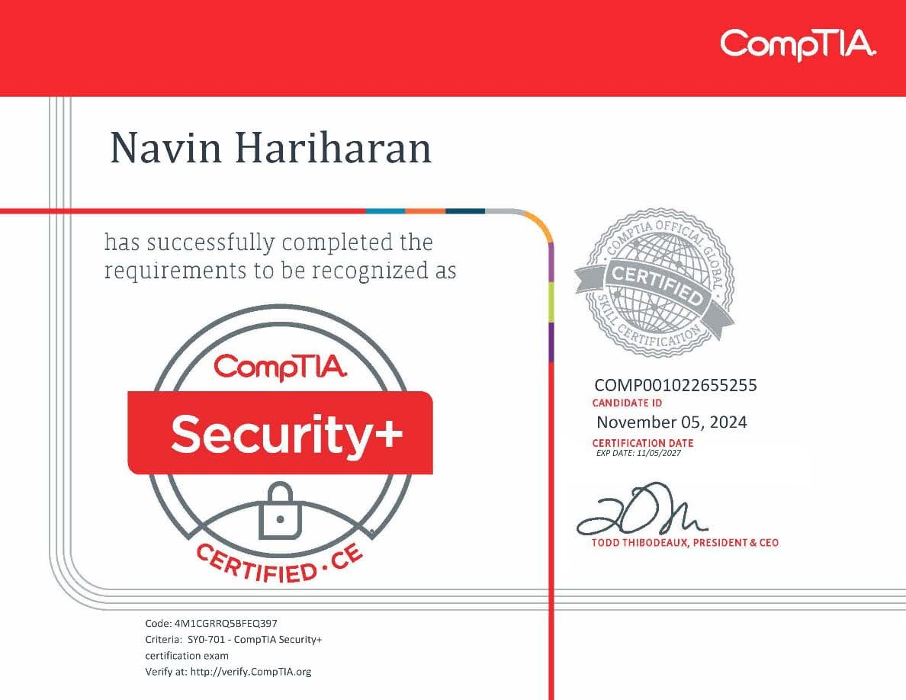

<div align="center">


# Navin Hariharan

### `Ethical Hacker` · `AI Researcher` · `Builder`

I break systems so they can be rebuilt stronger — then I teach machines to spot what I found.

[](https://navin-hariharan.com)
[](https://github.com/navin-hariharan)
[](https://huggingface.co/navin-hariharan)
[](https://in.linkedin.com/in/navin-hariharan)

</div>

---

## `whoami`

I'm **Navin Hariharan**, a cybersecurity professional and AI researcher. I hold an **MSc in Cybersecurity**, and I'm a **Certified Ethical Hacker** and **CompTIA Security+** holder.

My work lives at the meeting point of **offensive security** and **applied AI**: I run security engagements — finding how systems break and helping rebuild them — and I fine-tune open models on the problems I meet in the field, from vulnerability data to image generation. Alongside that I build and self-host real infrastructure, and I ship open-source tools and game mods for the fun of it.

<div align="center">

</div>

## `./focus`

```
┌─ OFFENSIVE SECURITY  web · network · wireless assessments that end in fixes
├─ APPLIED AI          fine-tuning open models on security & domain data
├─ INFRASTRUCTURE      self-hosted, observable, backed-up — home lab to company domain
└─ BUILDING            APIs, dashboards and mods, written to be read by the next person
```

## `./stack`


## `./work`

A few things I've built — security, AI and open source:

| Project | What it is |
|---------|-----------|
| **[CVE Intelligence](https://github.com/navin-hariharan/CVE-DATABASE)** | An open vulnerability database, a 265k-row [CVE dataset](https://huggingface.co/datasets/navin-hariharan/cve-dataset) and a [Qwen2.5 model](https://huggingface.co/navin-hariharan/qwen2.5-cve-trained) fine-tuned to reason about exploits. |
| **[Donwinne](https://github.com/navin-hariharan/Donwinne)** | A Petri-net editor and simulator, paired with [models](https://huggingface.co/navin-hariharan/qwen2.5-petri-nets) trained to read and generate nets. |
| **[FLUX LoRA](https://huggingface.co/navin-hariharan/navin-hariharan-FLUX-LORA)** | Personal FLUX LoRA fine-tunes served through a [RunPod worker](https://github.com/navin-hariharan/FLUX-INFERENCE-LORA). |
| **[Create ICBM](https://github.com/navin-hariharan/create-icbm)** · **[Pengu's Teams](https://github.com/navin-hariharan/penguteams)** | Minecraft mods — tiered missiles, and teams with chunk claiming. |
| **[TeleRat](https://github.com/navin-hariharan/TeleRat)** · **[Payload Master](https://github.com/navin-hariharan/PAYLOAD_MASTER)** | Red-team lab tooling for remote access and payload generation. |

## `./credentials`

<div align="center">

&nbsp;&nbsp;


**Certified Ethical Hacker** — EC-Council · **CompTIA Security+** — CompTIA
</div>

## `./stats`

<div align="center">


</div>

## `./contact`

```
> cat ~/.contact
  email   : navin@navin-hariharan.com
  web     : https://navin-hariharan.com
```

<div align="center">

*Have a system worth breaking? Let's talk.*

</div>

---

<sub>This repository is my personal portfolio site — a self-contained, no-build static site (HTML, CSS, vanilla JS and Three.js). See [`index.html`](index.html) to run it, or the [Dockerfile](Dockerfile) to containerise it.</sub>
